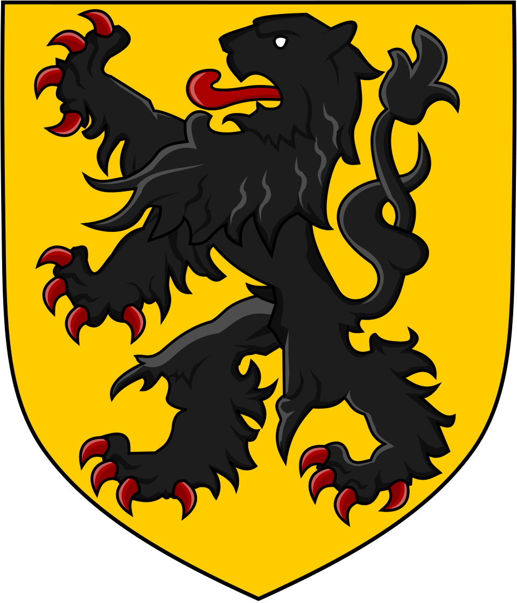

# 05 — Example file: `flanders.png`

Source: [`examples/flanders.png`](../examples/flanders.png), the coat of arms of Flanders (a black lion on a gold shield) from Wikimedia Commons, rendered at 960×1121 px with a transparent background.

The image is a raster, so it goes through the colour-reduction path of the auto-digitizer rather than the SVG path. It is a good v1 test case: few flat colours, one large fill, and a complex black silhouette with fine details.

## What's in the file

| Element | Approx. colour | Digitizing note |
|---|---|---|
| Shield background | `#f0c000` gold | Large tatami fill |
| Lion body, mane, limbs | `#1e1e1e` near-black | Fill for the large areas, satin for narrow limbs and the tail |
| Outline | `#000000` | Running stitch or narrow satin; runs along the shield edge and the lion contour |
| Fur highlights | `#4a4a4a` grey | Thin details, often below the 1 mm threshold at hoop size |
| Claws, tongue | `#a00000` dark red | Small fills with a lot of detail; many tiny objects |

Near-black and black are close enough that colour reduction may merge them, which is what you want for a sewable result.

## What it exercises

- Anti-aliasing removal along the many curved edges.
- Transparent background handling (the corners outside the shield).
- Tiny objects (claws) that must be dropped or merged below the minimum area.
- Satin versus fill decisions on a shape with widely varying width.
- Colour ordering: gold first, black lion over it, red details last.

## At a realistic size

Scaled to **100 mm tall × 85.6 mm wide**, which fits the 100×100 hoop. At that size the finest fur highlights and claw tips are below what a home machine can sew cleanly, so the digitizer is expected to simplify them and show a tip.

## Suggested sewing order

1. Gold fill (shield background).
2. Red details (claws, tongue), overlapping the lion edge slightly.
3. Black lion body, then outline last so it covers the fill edges.

## Two output modes

The primary target is a **standalone patch**; sewing directly on a garment is a second mode, chosen with a toggle in the export panel.

| | Standalone patch (default) | On fabric |
|---|---|---|
| Background fill | Stitched | Skipped for white only; coloured backgrounds stay |
| Edge | Satin border over the outline, running cut line just outside | Outline as designed |
| Fill density | Slightly stiffer for a firm patch | Lower density to keep the garment soft |
| Backing | Twill base plus cut-away or heat-seal stabiliser | Stabiliser chosen per fabric |

Both modes come from the same design; only the background objects and the border settings change.
