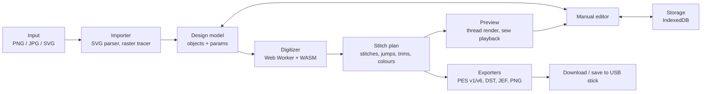

# 06 — System architecture

Everything runs in the browser: images never leave the user's machine, there is no per-conversion server cost (important for a free tool), and the geometry work is fast enough in WebAssembly inside a Web Worker. A backend is optional and only needed later for accounts, sharing or a design library.



The design model is the single source of truth: the editor and the digitizer both write to it, and every preview and export is derived from the stitch plan it produces.

## Components

| Component | Responsibility | Suggested tech |
|---|---|---|
| UI shell | Upload, hoop picker, panels, undo/redo | TypeScript + React or Svelte, Vite |
| SVG importer | Paths, transforms, styles, hidden layers; flatten curves | Browser `SVGPathElement` / svg-path parser, own transform stack |
| Raster tracer | Colour-reduce and vectorise PNG/JPG | k-means in Lab + Potrace (WASM) or OpenCV.js |
| Design model | Objects, params, order | Plain JSON, immutable updates, versioned schema |
| Digitizer engine | Classify, generate stitches, optimise order | TypeScript + Clipper2 (WASM), Web Worker |
| Preview renderer | Thread rendering, playback | Canvas2D for v1, WebGL (PixiJS) for > 50k stitches |
| Exporters | PES v1/v6, DST, JEF, EXP, PNG thumbnail | Own TypeScript writers, byte-tested against pyembroidery |
| Storage | Autosave, recent projects | IndexedDB (idb-keyval) |

## Data model (simplified)

```json
{
  "version": 1,
  "hoop": { "w": 100, "h": 100 },
  "fabric": "woven",
  "mode": "patch",
  "threads": [{ "id": "t1", "rgb": "#a70800", "brand": "Brother", "code": "800", "pec": 5 }],
  "objects": [{
    "id": "o12",
    "name": "RoodKasteel",
    "thread": "t1",
    "geometry": { "type": "polygon", "rings": [[[0, 0], [10, 0], [10, 10]]] },
    "stitch": { "type": "fill", "angle": 45, "spacing": 0.4, "length": 3.5,
                "underlay": ["edge", "tatami"], "pullComp": 0.2 },
    "entry": [0, 0], "exit": [10, 10],
    "locked": false
  }],
  "order": ["o3", "o12"]
}
```

- Geometry is stored in **millimetres**.
- The stitch plan is regenerated whenever an object changes — only that object is re-stitched, then travel between neighbours is re-planned.
- The stitch plan is a flat array of `{x, y, cmd}` with `cmd ∈ stitch | jump | trim | colour | end` — the shape every exporter consumes.

## Possible later additions

- Desktop wrapper (Tauri) around the same web app, if direct USB/Wi-Fi transfer becomes important.
- Pyodide-based fallback exporter (pyembroidery in the browser) for formats we haven't written ourselves.
