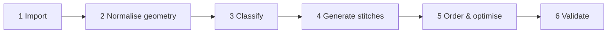

# 07 — Auto-digitizing pipeline

Auto mode runs six stages in a Web Worker and should turn a clean logo like the shield into a sewable plan in under 2 seconds. Each stage's output is kept, so manual mode can edit at any level.



## 1. Import

- **SVG**: resolve nested transforms, `style` vs attribute precedence, `display:none` / `visibility`, `<use>`, fill-rule (nonzero/evenodd) and units (viewBox × width/height in mm). Flatten Béziers to polylines at 0.05 mm tolerance. Strokes become objects too; their width decides running vs satin.
- **PNG/JPG**: flatten alpha onto the background colour, denoise (median 3×3 or bilateral), colour-reduce with k-means in CIELAB (auto k by elbow method, user override 2–15). Drop regions < ~2 mm² at target size, then trace each colour mask with Potrace (`turdsize`, `alphamax`, `opttolerance` exposed as "detail" and "smoothness" sliders).

## 2. Normalise geometry

- Scale to the chosen hoop (keep aspect, 3 mm margin); convert to 0.1 mm integer coordinates for Clipper2.
- Resolve occlusion: sewn region = shape minus every shape above it, where the upper shape is shrunk by the overlap (0.4 mm) so colours tuck under each other.
- Merge touching same-colour regions; remove slivers with a morphological opening (−r then +r, r = 0.3 mm).
- In "on white fabric" mode, skip the colour that matches the fabric.

## 3. Classify

Compute the medial axis (or a distance transform at 10 px/mm) per region:

| Local width | Stitch type |
|---|---|
| < 1 mm | Running along the centreline |
| 1–7 mm | Satin |
| > 7 mm | Tatami fill |

Regions that mix widths are cut at the transition into separate objects.

## 4. Generate stitches

- **Running**: resample at 2.5 mm, down to 1.5 mm where curvature is high.
- **Satin**: split the region into columns (skeleton branches), build two rails per column, place rungs perpendicular to the centreline at the chosen spacing, widen by pull compensation, add underlay; columns > 7 mm become split-satin.
- **Fill**: choose an angle (default: the one that minimises row breaks, tie-broken towards 45°), intersect parallel scanlines spaced 0.4 mm with the polygon, cut rows into 3.5 mm stitches with a 1/3 row offset, and link rows into sections sewn back and forth without jumps (graph of row segments + boundary edges, walked with an Eulerian path — Ink/Stitch's approach, reusable under GPL-3.0).
- Add underlay (see [04](04-embroidery-fundamentals.md#underlay)) beneath every satin and fill.

### Fill generation sketch

```ts
function tatami(poly: Polygon, angle: number, spacing = 0.4, len = 3.5, offset = 1 / 3) {
  const rotated = rotate(poly, -angle);
  const rows: Segment[][] = [];
  for (let y = minY(rotated) + spacing / 2, i = 0; y < maxY(rotated); y += spacing, i++) {
    const segs = intersectHorizontal(rotated, y);         // pairs of x where the line is inside
    rows.push(segs.map(s => stitchesAlong(s, len, (i * offset) % 1)));
  }
  const sections = linkRowsIntoSections(rows);           // graph + Eulerian walk (see Ink/Stitch)
  return sections.map(s => rotate(s, angle));
}
```

## 5. Order and optimise

Cost model for hobbyist single-needle machines: **colour change ≫ trim > travel length**.

1. Build a layering graph: if A is visually under B, A sews first.
2. Topologically sort it while grouping same colours, so colour changes are minimised without breaking layering. When two colours don't overlap at all, their order is free — use that freedom to merge blocks of the same colour.
3. Inside a colour, order objects with nearest-neighbour + 2-opt, choosing entry and exit points on each boundary closest to the neighbours.
4. Travel: a move < 3 mm whose path stays inside area that will be covered later becomes hidden running stitches; anything else becomes trim + jump. Because many hobby machines have no automatic cutter, prefer hidden travel even for somewhat longer moves (configurable).
5. Add tie-in / tie-off stitches around every trim.

## 6. Validate

Flag and report in a warnings panel (click to locate):

- stitches < 0.3 mm (removed) or > 12 mm (split);
- density hot-spots (stitches per mm² on a 1 mm grid above a threshold, e.g. 3+ stacked layers);
- design outside the hoop;
- gaps between colours;
- totals: stitches, trims, colour changes, estimated time.

## Quality targets

| Metric | Target for a 100 mm logo |
|---|---|
| Processing time | < 2 s (20k stitches) |
| Colour changes | = number of distinct colours, unless layering forces more |
| Trims | < 3 per colour on simple logos |
| Hidden travel | > 80% of moves under 3 mm |
| Density warnings | 0 at default settings |

Benchmark set: the shield, lettering-only logos, a photo-like PNG (expect poor results and warn), thin-line art.

## Additions after the hand-digitized comparison

See [13](13-hand-digitized-comparison.md) for the reasoning.

- **Patch border** (patch mode): the outer 3.5 mm of the design becomes a satin ring in the colour that forms most of the edge, sewn last.
- **Layered fills**: after a first pass decides the sewing order, each fill colour is grown under thin colours sewn after it (morphological closing, 2 mm) and tucked 0.35 mm under neighbours (not under thin running lines). If the user reorders colours so a covering colour comes first, the shape falls back to its own pixels.
- **Fill angle** 135° by default; spacing 0.25 mm, stitch length 4 mm.
- **Satin**: stitch direction = shortest chord across the stroke; stitch positions keep the outer edge's density with shortened inner stitches; strokes with junctions are split into one column per direction; minimum column width 1.2 mm.
- **Thin line webs** (many junctions, mean width < 1.6 mm) become triple-run lines.
- **Travel routing** snaps needle points to the nearest allowed pixel and allows hidden routes up to 40 mm.
