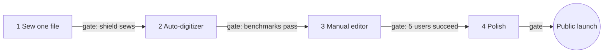

# 10 — Roadmap

Four phases, each closed by a gate tested on real fabric or with real users. Not to scale; no dates set yet.

| Phase | Scope | Gate |
|---|---|---|
| **1 · Sew one file** | PES v1 writer, SVG import, running + fill stitches, basic preview | The shield sews correctly on a real Brother machine *(needs the test machine model)* |
| **2 · Auto-digitizer** | Satin + underlay, pull compensation, order/trims/travel, PNG tracing | Benchmark set meets the [quality targets](07-auto-digitizing.md#quality-targets) |
| **3 · Manual editor** | Tools + sequence panel, sew simulator, density map, undo + autosave | 5 hobbyist users finish a design unaided |
| **4 · Polish** | PES v6 + thread charts, DST/JEF/EXP export, lettering, optional accounts | Public launch (open-source release, GPL-3.0) |

Phase 1 is the critical proof: a file from our own writer sewing correctly on a Brother machine.

## Status (2026-10-25)

- **Phase 1 — built, gate open.** PES v1 writer (byte-identical to pyembroidery for header + stitches), SVG/PNG import, running/satin/fill, preview. Waiting for a first sew on a real Brother machine.
- **Phase 2 — mostly built.** Satin + underlay, pull compensation, colour ordering, hidden travel, PNG tracing. Open: lettering quality, fewer trims.
- **Phase 3 — partly built.** Sequence panel, per-shape properties, simulator, density map, undo, autosave. Open: drawing tools, node edit, knife, stitch-level edits.
- **Phase 4 — partly built.** DST and EXP export, project files. Open: PES v6, JEF, lettering, accounts.

See `app/README.md` for details.
